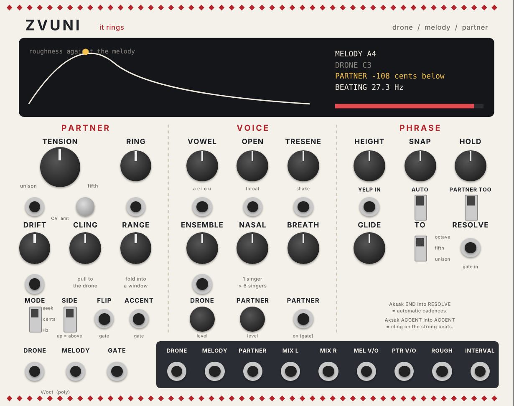
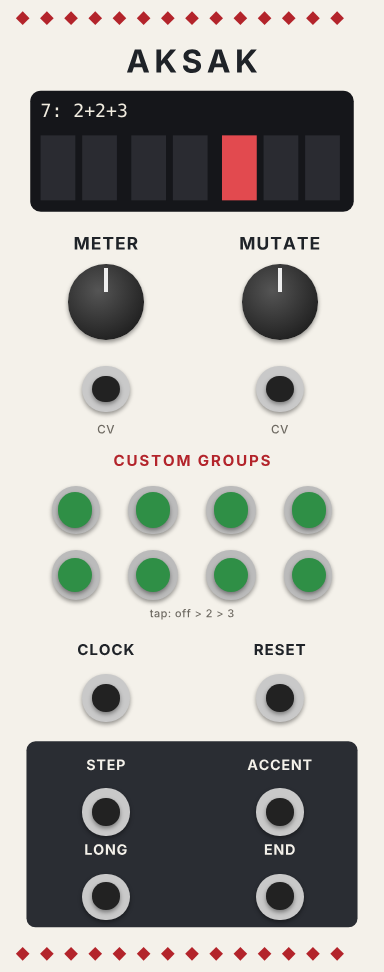

# Zvuni

A VCV Rack 2 plugin with two modules, inspired by Bulgarian women's singing.

- **Zvuni** ("it rings") is a three-voice singer: a **drone**, a **melody**, and a **partner** that sits a microtonal second away from the melody. The partner is tuned to a target *roughness* (how fast the two voices beat against each other) instead of a fixed interval, the way village singers tune by ear. One knob, **Tension**, takes it from unison through the ringing second to an open fifth.
- **Aksak** is a clock divider for Bulgarian "limping" meters: 2+2+3, 2+2+2+3, 2+2+3+2+2 and your own.

Everything is synthesised, so there is nothing to clear if you use it on a record.



## Quick start

1. Patch a pitch (V/oct) and gate into Zvuni's **MELODY** and **GATE** at the bottom left. Leave **DRONE** empty for now: the drone takes the first note of each phrase.
2. Listen to **MIX L / R**.
3. Turn **TENSION** slowly from fully left. At about 60% the partner reaches the "peak ring". Past that it opens out, and fully right it is a fifth.
4. Clock **Aksak** with 16ths, patch its **ACCENT** into Zvuni's **ACCENT** and its **END** into **RESOLVE**. Turn up **CLING**: the melody now leans onto ringing notes on the strong beats, and every cycle ends on a cadence.

## The idea

Two tones beat when they are close in pitch. The ear finds that beating roughest at about a quarter of a "critical band" apart, which works out to roughly 25 to 35 beats a second in the singing range. Bulgarian singers move the second voice until it rings hardest, so the interval they land on depends on the pitch:

| Melody note | Gap for peak ring | As an interval |
|---|---|---|
| A3 (220 Hz) | ~26 Hz | ~193 cents (almost a whole tone) |
| A4 (440 Hz) | ~28 Hz | ~108 cents (about a semitone) |
| E5 (660 Hz) | ~32 Hz | ~83 cents (less than a semitone) |

In **Hz** mode Zvuni does the same: as the melody climbs, the partner moves closer in cents so the rub stays the same strength. Switch to **Cents** mode to hear the difference with a fixed interval.

## The display

- **Left: the roughness curve** for the note the melody is singing right now. Left edge = unison, then semitone, tone, 4th, 5th (the scale is stretched so the small intervals get more room). The **gold dot** is where the partner is. The small **red mark** on the bottom is where Ring puts the peak.
- **Right:** melody and drone notes, the partner's offset in cents, how fast the voices are beating, the mode, and **RESOLVING** or **YELP!** when they happen. With more than one channel it shows channel 1.
- **RING bar:** how hard melody and partner are ringing right now (same as the ROUGH output).

## Zvuni controls

### Partner

| Control | What it does | CV |
|---|---|---|
| **TENSION** | 0 = unison. Up to about 60% the gap grows to peak roughness. 60 to 80% goes past the peak to a wide whole tone. 80 to 100% glides out to a perfect fifth. Ride this one knob to arrange a track | ±5 V, with the **amt** trimpot |
| **RING** | Where the peak sits, 0.5x to 2x the natural spot. Low = slow, wobbly beating. High = fast and buzzy | ±5 V (+5 V doubles it) |
| **DRIFT** | Slow random wander of the partner's tuning, up to ±25 cents, so it never sits perfectly still | 0 to 10 V |
| **CLING** | Pulls the melody towards notes that ring against the drone: unison, a ringing second either side, 4th, 5th, octave. Stronger while ACCENT is high. Fully up, the melody only lands on those | |
| **RANGE** | Keeps the melody within this many semitones above the drone (and up to a tone below), folding notes back in. Fully right = off | |
| **MODE** | **Hz** (bottom): tracks roughness, the singer. **Cents** (middle): a fixed interval set by Tension, measured at A4. **Seek** (top): the partner hunts around the target and settles, like a singer finding the spot. Seek speed is in the right-click menu | |
| **SIDE** | Down = partner below the melody (more typical), up = above | |
| **FLIP** | Gate: while high, the partner swaps sides | |
| **ACCENT** | Gate: makes Cling pull harder. Patch Aksak's ACCENT here | |

### Voice

| Control | What it does | CV |
|---|---|---|
| **VOWEL** | a > e > i > o > u. The default sits between a and e, the open sound of the recordings | 0 to 10 V |
| **OPEN** | Open throat: brighter, more pushed, more forward. Shortens the vocal-cord pulse and lifts the upper formants | 0 to 10 V |
| **TRESENE** | The fast, uneven shake on held notes. It only starts after a note has been held about a quarter of a second | 0 to 10 V |
| **ENSEMBLE** | Fully left = village: one raw singer per part, tuned exactly. Turning right adds up to 6 singers per part with small differences in tuning, timing and vowel, spreads them in stereo, and pulls the partner slightly towards tempered tuning, like a big choir | 0 to 10 V |
| **NASAL** | A dip around 1 kHz and a peak near 2.5 kHz | |
| **BREATH** | Air in the voice | |
| **DRONE level**, **PARTNER level** | Mix of those two parts | |
| **PARTNER on** | Gate: the partner only sings while this is high. Unpatched = always on | |

### Phrase

| Control | What it does |
|---|---|
| **HEIGHT** | How far the yelp flips up, 3 to 12 semitones |
| **SNAP** | How fast: about 20 ms (a glottal crack) to 150 ms (a whoop) |
| **HOLD** | Auto yelps happen only after notes held at least this long (0.1 to 2 s) |
| **YELP IN** | Trigger: yelp now. The voice flips up and drops out until the next note |
| **AUTO** | Up = yelp automatically when a long-enough note ends |
| **PARTNER TOO** | Up = the partner yelps with the melody |
| **GLIDE** | How long a resolve takes, 10 ms to 4 s |
| **TO** | Resolve to unison (bottom), fifth (middle) or octave (top) |
| **RESOLVE** | Gate: while high, the partner glides to the TO interval, whatever Tension says. Patch Aksak's END here for a cadence at the end of every cycle |

### Jacks along the bottom

| Jack | |
|---|---|
| **DRONE in** | Drone pitch, V/oct. Unpatched = the first melody note after a quarter second of silence |
| **MELODY in** | Melody pitch, V/oct, up to 4 channels. Each channel gets its own melody and partner voices |
| **GATE in** | Melody gates (poly). Unpatched = always singing |
| **DRONE**, **MELODY**, **PARTNER** | Each part's audio on its own, for processing in Live. Melody and partner are poly |
| **MIX L / R** | Everything mixed, in stereo |
| **MEL V/O** | The melody's pitch after Range and Cling. Send it to hardware |
| **PTR V/O** | The partner's pitch. Send it to Mangrove or Just Friends and let Zvuni be the tuning brain |
| **ROUGH** | How hard melody and partner are ringing, 0 to 10 V. Good for filter cutoff or sidechain depth |
| **INTERVAL** | The partner's distance from the melody, 1 V per semitone (negative = below) |

## Aksak



| Control | What it does |
|---|---|
| **METER** | 5 (2+3), 7 (2+2+3) Rachenitsa, 7 (3+2+2), 9 (2+2+2+3) Daychovo, 11 (2+2+3+2+2) Kopanitsa, 13, 15, or Custom. A change waits for the end of the current cycle. CV: each 1.25 V moves one meter on |
| **MUTATE** | Chance each cycle that one group flips between 2 and 3 (and a smaller chance that a second one does). The base meter comes back every time, so it limps differently but never drifts away. CV 0 to 10 V |
| **CUSTOM GROUPS** | Eight buttons used when METER is on Custom. Tap to cycle off > 2 (green) > 3 (red). Empty groups are skipped |
| **CLOCK** | One pulse per step (16ths from Live work well) |
| **RESET** | The next clock starts the cycle again |
| **STEP** | A trigger on every clock |
| **ACCENT** | A trigger at the start of each group |
| **LONG** | A trigger at the start of each group of 3 |
| **END** | A gate that is high during the last group of the cycle |

The display shows the current cycle as boxes, with a gap between groups and a red mark on groups of 3.

## Patch ideas

1. **Tension as arrangement.** Hapax sends a drone note and a slow melody. Map TENSION to a Live macro through CV Tools and the disting NT, and automate it: verses near unison, the build climbing to the peak, the drop snapping out to a fifth with RESOLVE.
2. **Roughness drives the track.** ROUGH into a filter cutoff or the kick sidechain amount: the more the voices rub, the more the rest reacts.
3. **Aksak hats over a Detroit kick.** Kick stays on four from Live. Aksak on 7 drives the hats from STEP and an open hat from LONG. Bring MUTATE up slowly.
4. **Tuning brain for the rig.** PTR V/O to Mangrove, MEL V/O to Just Friends, both through Three Sisters in formant mode. Turn Zvuni's own levels down.
5. **Hear why singers do it.** Play a melody that climbs an octave and flip MODE between Hz and Cents.

## Build it yourself

GitHub Actions builds the Mac Apple Silicon plugin on every push to `main` and puts it on the [latest release](https://github.com/hardyfinn/zvuni/releases/tag/latest).

```sh
c++ -std=c++11 -O2 -o test/engine_test test/engine_test.cpp && test/engine_test   # engine tests
python3 res/make_panel.py                                                         # redraw the panels (needs fonttools)
make dist RACK_DIR=/path/to/Rack-SDK                                              # build the plugin
```

The engines (`src/ZvuniEngine.hpp`, `src/AksakEngine.hpp`) have no VCV code in them, so the tests run on their own.

## Notes

The roughness model is the standard critical-band approximation, not a measurement of any particular singer. The interval figures for Bulgarian singing are ballpark values from the ethnomusicology literature.
